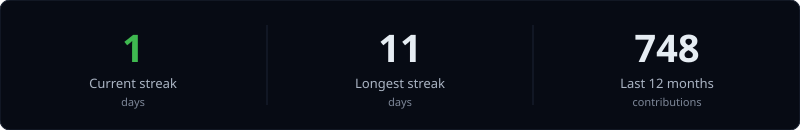
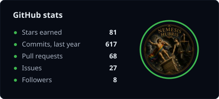
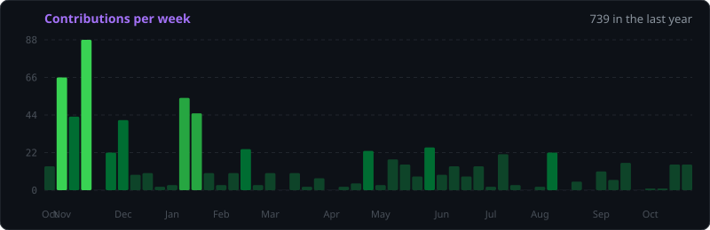

  

  

---

### About Me

* **Kindle Jailbreaking:** I run **Kindlemodshelf.me** and host a collection of modding resources. I help people get their devices sorted.
* **Reverse Engineering:** I reverse engineer APIs, Chrome extensions, and closed software ecosystems. I also do security research on HackerOne.
* **OS & Hardware:** I run a home server and daily drive Fedora on my main machines (As Linus Torvalds does).
* **Academics:** Currently earning a degree in biochemistry.
* **AI Take:** Grok is the best. Claude and ChatGPT suck.

---

### Stats

  

  
  

  

  <picture>
    <source media="(prefers-color-scheme: dark)" srcset="./profile/snake-dark.svg" />
    <source media="(prefers-color-scheme: light)" srcset="./profile/snake.svg" />
    
  </picture>

Cards rebuild every 6 hours by a GitHub Action. Nothing here depends on an outside server.
